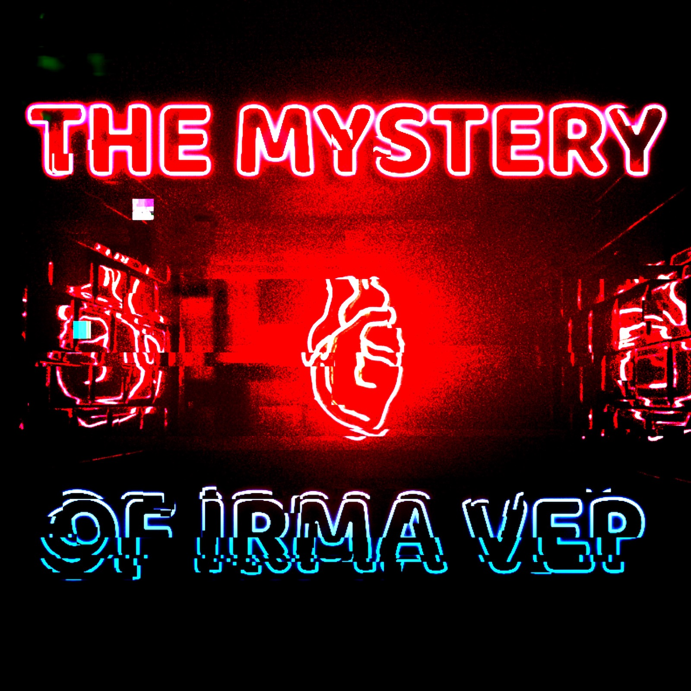

## The Mystery of Irma Vep

An original soundtrack for the classic Charles Ludlam play. Listen along as this satire of melodrama, farce, penny dreadful, and Hitchcock films unfolds. Composed for a 2021 production of the play. 

### Available now on Spotify and Apple Music

---

<iframe src="https://open.spotify.com/embed/album/64SmWIOUVGtcR6CDTO6Yxs?utm_source=generator" width="400" height="480" frameborder="0" allowtransparency="true" allow="encrypted-media"></iframe>

---

<iframe src="https://embed.music.apple.com/us/album/the-mystery-of-irma-vep-music-from-the-stage-play/1589699944?app=music&amp;itsct=music_box_player&amp;itscg=30200&amp;ls=1" height="450px" frameborder="0" sandbox="allow-forms allow-popups allow-same-origin allow-scripts allow-top-navigation-by-user-activation" allow="autoplay *; encrypted-media *;" style="width: 100%; max-width: 660px; overflow: hidden; border-radius: 10px; background: transparent;"></iframe>

